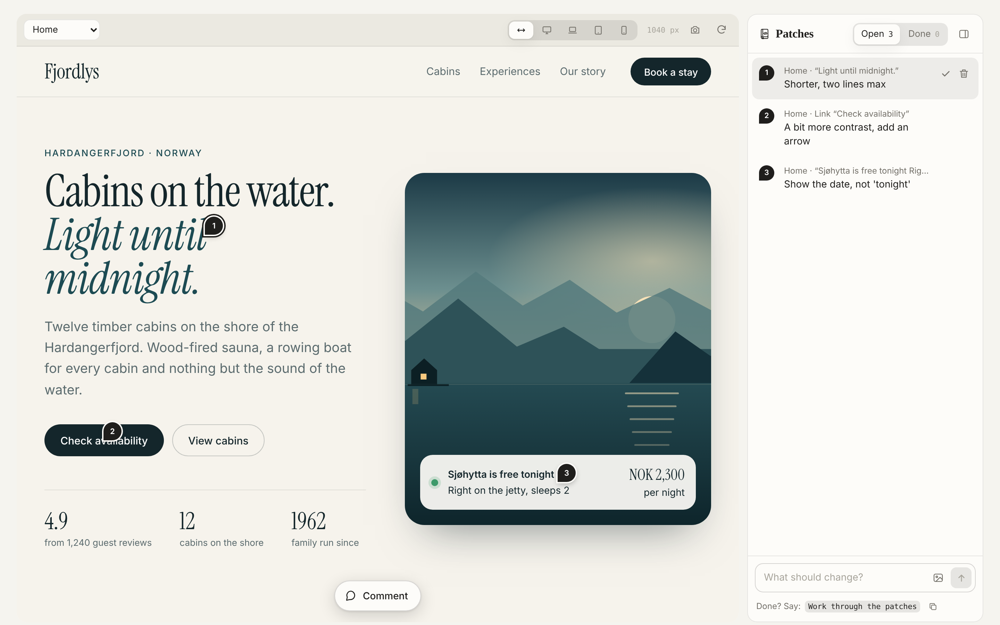
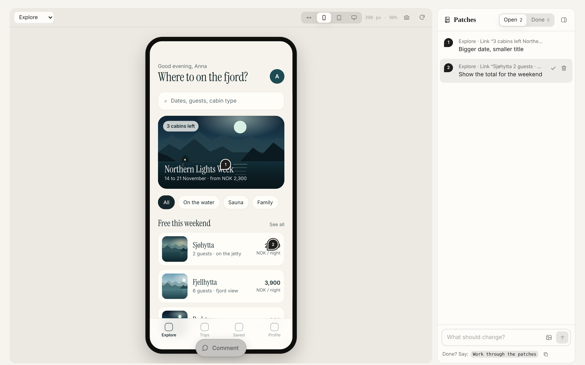
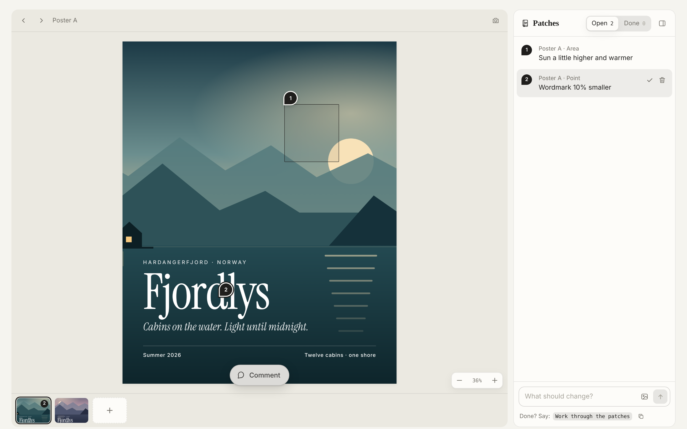
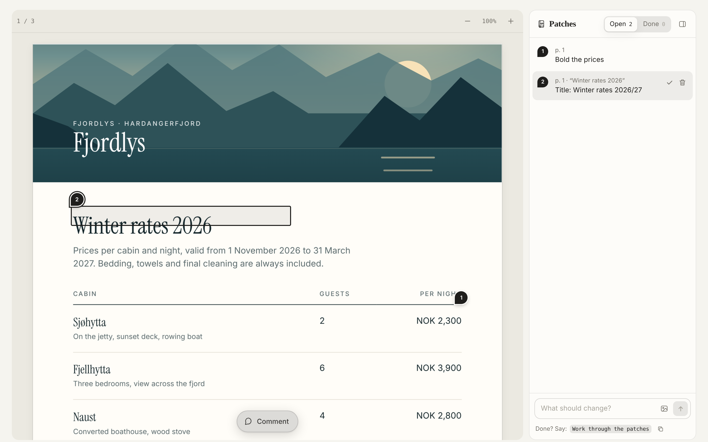
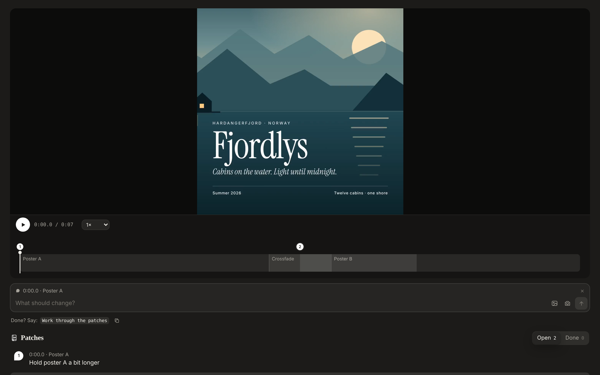

<p align="center">
  <picture>
    <source media="(prefers-color-scheme: dark)" srcset="docs/logo-weiss.svg">
    
  </picture>
</p>

<h1 align="center">Patchbook</h1>

<p align="center">
  Review skills for Claude. Comment right on the website, app, image, PDF, audio or video Claude builds for you,<br>
  and Claude works through every patch.
</p>

<p align="center">
  <a href="https://github.com/justsecretzone/Patchbook/releases/latest"><b>Download</b></a> ·
  <a href="#install">Install</a> ·
  <a href="#how-a-review-goes">How it works</a> ·
  <a href="#skills">Skills</a>
</p>

<p align="center">
  
  
  
  
</p>

<p align="center">
  
</p>

## Why

Giving feedback on generated work in a chat is clumsy: "the second button in the hero, a bit darker, and on mobile the headline wraps badly". Patchbook replaces that with a review page next to every piece of work. You point at the exact spot, write one line, attach a screenshot if it helps. When you're done, you tell Claude, and it works through the list, publishes the next version and closes each patch with a note on what changed.

## Skills

| Skill | What you review | How you comment |
| --- | --- | --- |
| [`website-review`](skills/website-review) | The live site, fully clickable | Pin patches on real elements. Breakpoints: Auto (the width you're looking at, default), Desktop, Laptop, Tablet, Mobile |
| [`app-review`](skills/app-review) | The live app in a device frame, or native screens as images | Pin patches on elements, switch screens and devices |
| [`image-review`](skills/image-review) | Images, posters, logos, variants | Click for a point, drag for an area, zoom and pan |
| [`pdf-review`](skills/pdf-review) | Every page of a PDF | Click or drag on a page, the text underneath is captured |
| [`audio-review`](skills/audio-review) | Songs, mixes, jingles, voiceovers | Waveform timeline: tap to jump, hold to zoom, drag for a range |
| [`video-review`](skills/video-review) | The current cut | Scene bar: tap to jump, hold to zoom, drag for a range, attach a frame |

## Features

- **Comment where it is.** Pins sit on the element, the spot or the moment. Drag a pin to move it; on websites it re-attaches to the element underneath.
- **Screenshots everywhere.** Paste, drop or attach images to any patch. On websites, apps and images you can import a screenshot as its own board and pin patches on it.
- **Nothing gets lost.** Patches stay on the page they were made on, and small pills show pins that are scrolled out of view.
- **Claude works through them.** Patches show "Claude is on it" while it works, then move to Done with a one-line reply.
- **The work gets the space.** A collapsible sidebar where you comment on a surface, a list under the player for audio and video, a bottom sheet on phones, one floating Comment button.
- **Your language, your theme.** The page speaks the language you write to Claude in and follows Claude's light or dark setting.
- **Temporary by design.** Once you approve the final version, Claude takes the review page offline.

<table>
  <tr>
    <td></td>
    <td></td>
  </tr>
  <tr>
    <td></td>
    <td></td>
  </tr>
</table>

## Install

Get the skills from the [latest release](https://github.com/justsecretzone/Patchbook/releases/latest): `patchbook-skills.zip` holds all six, and each skill is also available on its own (`website-review.zip`, `video-review.zip`, ...). You can also download this repository with **Code → Download ZIP** or clone it.

### Claude (web, desktop, mobile)

1. Download a single skill zip from the release, for example `website-review.zip`.
2. In Claude go to **Customize → Skills**, click **+**, then **Create skill → Upload a skill**, and choose the zip.
3. Repeat for every skill you want. Code execution and file creation need to be on (Settings → Capabilities).

From then on Claude adds the review page on its own whenever it builds something of that kind.

### Claude Code

```
/plugin marketplace add justsecretzone/Patchbook
/plugin install patchbook@patchbook
```

Or copy the folders from `skills/` into `~/.claude/skills/`.

### ChatGPT

Skills are available on ChatGPT Business, Enterprise and Edu: **Plugins → Skills → Create → Upload from your computer**, then upload a skill zip. Shared patches and screenshot uploads need Claude's artifact runtime, so outside Claude the review page keeps patches in your browser. When you're done, click **Copy patches** and paste them into the chat.

## How a review goes

1. You ask Claude for a landing page. It builds the site and publishes the review page with the site embedded.
2. You tap **Comment**, click the headline, write "shorter, two lines max", paste a reference screenshot, press Enter. Repeat.
3. You tell Claude **"Work through the patches"** (or "Patches abarbeiten").
4. Claude reads the open patches, looks at every screenshot, changes the site, publishes v2 and closes each patch with a note.
5. When you approve the final version, Claude takes the review page offline after you confirm.

## Data

Each patch is one document in the review page's database:

```js
{
  n: 4,                                   // number on the pin and in the list
  text: "Button darker",
  status: "open" | "working" | "done",
  anchor: { ... },                        // where it sits, per medium (see each SKILL.md)
  label: "Start · Button “Book now” · Mobile",
  shots: ["<assetId>"],                   // attached screenshots
  version: "v2", kind: "website", created: 1761400000000, author: "<user id>",
  reply: "Button now #1d2a2c, hover lighter", doneAt: 1761400500000
}
```

Patches and screenshots live in the review page itself (its database and asset store), visible to whoever the page is shared with. They are deleted together with the page when the review is finished.

## Repository

```
skills/<name>-review/
  SKILL.md                        instructions Claude follows
  assets/review-template.html     the finished review page, built from src/
src/
  core.js, core.css               patch list, composer, screenshots, image canvas, timeline
  interface.js, interface.css     live website / app frame with element pins and breakpoints
  media.js, media.css             audio and video
  <kind>.html                     one wrapper per skill with its CFG block
  build.py                        writes the templates into skills/
.claude-plugin/                   Claude Code plugin and marketplace manifest
docs/                             logo and screenshots
```

To change a review page, edit `src/`, run `python3 src/build.py` and commit both.

## Contributing

Issues and pull requests are welcome. Please describe what you reviewed (website, app, image, PDF, audio or video) and attach a screenshot if something looks off. Changes to the review pages go into `src/`; run `python3 src/build.py` before committing. See the [changelog](CHANGELOG.md) for what changed between releases.

## Disclaimer

Patchbook is an independent open-source project and is not affiliated with, endorsed by or sponsored by Anthropic or OpenAI. Claude is a trademark of Anthropic, ChatGPT is a trademark of OpenAI.

- The screenshots in this README show made-up example content (a fictional cabin rental called "Fjordlys"). The repository contains no demo content; the skills create a review page for your own work.
- Review pages are published as artifacts in your own Claude account. Patches and screenshots are stored there and are visible to anyone you share the page with. Don't attach screenshots with sensitive data to pages you share.
- Features depend on what your Claude plan and app version offer (skills, artifacts, code execution). Outside Claude only the local mode is available.
- Provided as is, without warranty, under the MIT license.

## License

[MIT](LICENSE) · Made by [Justus Langowsky](https://langowsky.com)
